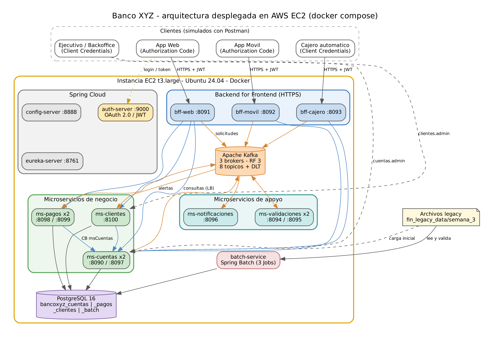
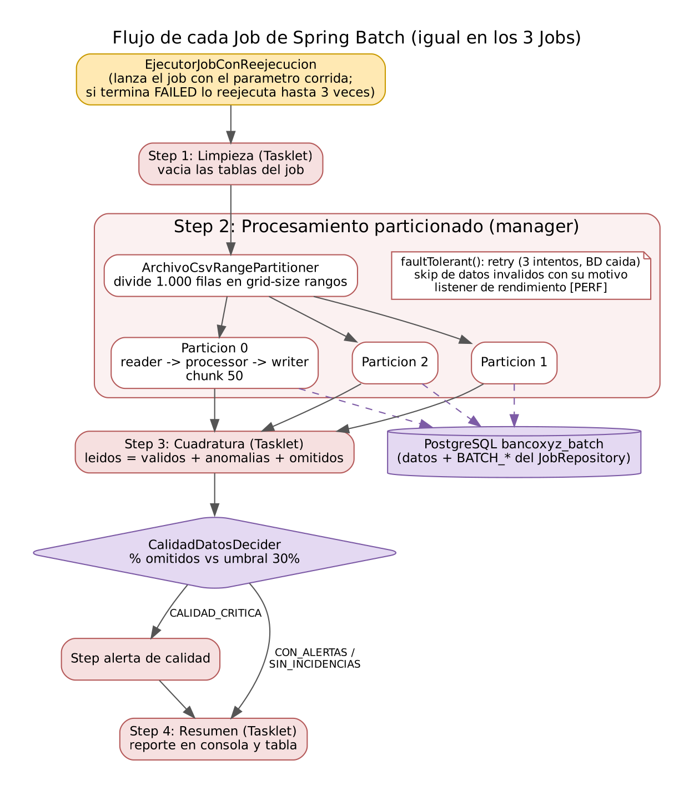
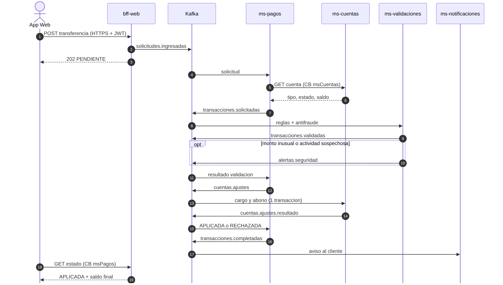

# Banco XYZ: Desarrollo Backend Avanzado con Spring Cloud y Batch

**Desarrollo Backend III (PBY2203). Evaluación Final Transversal**
**Autor:** Joaquín Gómez Flores

**Repositorio:** https://github.com/KakoGF/EFT-BackendIII

En este repositorio está el código fuente completo del proyecto:

| Contenido | Dónde |
| --- | --- |
| Descripción general del proyecto | `readme.md` (este archivo) |
| Código fuente de los 12 proyectos | Una carpeta por proyecto (sección 9) |
| Diagramas (arquitectura, flujo batch, saga, casos de uso) | `docs/` |

---

## 1. Objetivo y alcance

El Banco XYZ tiene un sistema legacy en COBOL y scripts Shell que corre en un mainframe. Este proyecto lo reemplaza por una
arquitectura de microservicios en la nube, que se construyó durante el semestre y se terminó en esta evaluación:

1. **Migración de los procesos batch a Spring Batch:** reporte de transacciones diarias, cálculo de intereses mensuales y
   estados de cuenta anuales, procesando los archivos oficiales `fin_legacy_data/semana_3` (1.000 registros cada uno).
2. **Backend for Frontend:** un BFF por canal (web, móvil y cajero automático), cada uno con su propio formato de respuesta,
   su propia autenticación y HTTPS.
3. **Microservicios resilientes con Spring Cloud:** Gestión de Cuentas, Procesamiento de Pagos y Gestión de Clientes, con
   Config Server, Eureka, balanceo de carga, OAuth 2.0, Resilience4j y eventos en Kafka.
4. **Despliegue en la nube:** todo corre con Docker Compose en una instancia EC2 de AWS, con tres microservicios escalados
   horizontalmente.



## 2. Procesos clave de la migración (criterio 1)

| # | Proceso clave | Dónde está en el proyecto |
| --- | --- | --- |
| 1 | Migración de procesos batch a Spring Batch | `batch-service` (3 Jobs particionados) |
| 2 | División del monolito en microservicios | `ms-cuentas`, `ms-pagos`, `ms-clientes` + `ms-validaciones`, `ms-notificaciones` |
| 3 | Patrón Backend for Frontend | `bff-web`, `bff-movil`, `bff-cajero` |
| 4 | Seguridad distribuida con Spring Security | `auth-server` (OAuth 2.0 / JWT) y todos los servicios como servidores de recursos |
| 5 | Mensajería asíncrona con Apache Kafka | Clúster de 3 brokers y 8 tópicos de eventos |

## 3. Requerimientos del negocio y decisiones de arquitectura (criterio 2)

| Requerimiento del negocio | Decisión | Por qué |
| --- | --- | --- |
| **Escalabilidad**: el mainframe no crece con la demanda | Microservicios independientes, cada uno con su base de datos, registrados en Eureka y con 2 instancias de los servicios más usados | Se puede agregar otra instancia de un servicio sin tocar los demás. Eureka y el `LoadBalancerClient` reparten las llamadas HTTP (round-robin) y Kafka reparte las particiones entre las instancias de un mismo grupo |
| **Disponibilidad y tolerancia a fallos**: hoy un módulo caído bota todo el sistema | Resilience4j (Circuit Breaker, fallback y Rate Limiter), Kafka con replicación 3 y reintentos con Dead Letter Topic | Si se cae un servicio, el resto responde con una versión degradada en vez de un error. Las operaciones quedan guardadas en Kafka y se procesan cuando el servicio vuelve |
| **Seguridad**: hoy la seguridad es centralizada y limitada | OAuth 2.0 con un Servidor de Autorización propio, tokens JWT con scopes por canal y por servicio, y HTTPS en los BFF | Cada servicio valida el token por su cuenta (seguridad distribuida). Un cliente solo puede hacer lo que su scope le permite |
| **Eficiencia de los procesos batch**: el proceso nocturno es lento y frágil | Spring Batch con particiones, chunks, skip, retry, cuadratura y reejecución automática | Los 1.000 registros se procesan en paralelo, los datos malos se omiten dejando su motivo y un corte temporal no obliga a partir de cero |
| **Distintos canales con distintas necesidades** | Un BFF por canal | La web recibe datos completos, el móvil respuestas livianas y el cajero solo lo que necesita una operación crítica |

## 4. Parte 1: Spring Batch (criterio 3)

Los tres procesos legacy quedaron como tres Jobs en `batch-service`. Leen los CSV oficiales desde la carpeta `datos-legacy/`
(copiados sin cambios desde `KariVillagran/fin_legacy_data`, carpeta `data/semana_3`) y guardan el resultado en PostgreSQL.

| Job | Archivo legacy | Qué hace |
| --- | --- | --- |
| `jobReporteTransaccionesDiarias` | `movimientos_financieros_diarios.csv` | Normaliza fechas, detecta anomalías (monto negativo, cero o tipo desconocido) y genera el resumen diario |
| `jobCalculoInteresesMensuales` | `intereses_trimestrales.csv` | Valida saldo, edad y tipo de producto, y calcula el interés mensual según el tipo de cuenta |
| `jobGeneracionEstadosCuentaAnuales` | `estados_financieros_anuales.csv` | Compila los movimientos del año por cuenta (abonos, cargos y saldo neto) para auditoría |



**Lo que tiene cada Job:**

- **Paralelismo:** cada archivo se divide en rangos (`ArchivoCsvRangePartitioner`, `grid-size` 3) y cada partición corre en
  su propio hilo, con chunks de 50 registros.
- **Manejo avanzado de errores:** `DatosInconsistentesSkipPolicy` omite los datos inválidos y deja el motivo en una tabla de
  errores. Una excepción que no es de datos detiene el Step.
- **Reintentos ante fallos temporales:** `PoliticaReintentos` reintenta hasta 3 veces con espera creciente cuando la base de
  datos no responde (`TransientDataAccessException` y `DataAccessResourceFailureException`, que es la que lanza Spring
  cuando se corta la conexión).
- **Reejecución automática:** `EjecutorJobConReejecucion` lanza el Job y, si termina en `FAILED`, lo vuelve a ejecutar con los
  mismos parámetros (hasta 3 veces). Spring Batch retoma desde lo que quedó pendiente: los Steps y las particiones ya
  completadas no se repiten.
- **Política de finalización:** `CalidadDatosDecider` calcula el porcentaje de registros omitidos. Si supera el 30%, el Job
  pasa por un Step de alerta antes del resumen.
- **Cuadratura:** un Step comprueba que `leídos = válidos + anomalías + omitidos`. Es la forma de demostrar que no se perdió
  ningún registro y que el resultado es equivalente al del legacy.
- **Fechas legacy:** se aceptan los 4 formatos que trae el archivo (`yyyy-MM-dd`, `yyyy/MM/dd`, `dd-MM-yyyy` y `dd/MM/yyyy`),
  validando que la fecha exista de verdad (por ejemplo, `2024-13-01` se rechaza).

**Resultados sobre el dataset oficial (1.000 registros por archivo):**

| Job | Válidos | Anomalías | Omitidos (con motivo) | % omitido | Decider | Cuadra |
| --- | --- | --- | --- | --- | --- | --- |
| Transacciones diarias | 392 | 397 | 211 (162 sin monto, 49 con fecha `2024-13-01`) | 21,1% | CON_ALERTAS | Sí |
| Intereses mensuales | 421 | – | 579 (171 sin edad, 165 sin saldo, 200 tipo inválido, 42 edad fuera de rango, 1 duplicado) | 57,9% | CALIDAD_CRITICA | Sí |
| Estados anuales | 603 | 348 (116 monto cero, 232 monto negativo) | 49 (48 sin monto, 1 duplicado) | 4,9% | CON_ALERTAS | Sí |

**Supuestos:**

- Tasas mensuales: ahorro 1,5%, préstamo 2,0% e hipoteca 2,5%.
- La edad válida va de 0 a 100 años.
- En los estados anuales, un monto negativo o cero se guarda como anomalía y no se suma al saldo.

## 5. Parte 2: Backend for Frontend (criterio 4)

| | bff-web (8091) | bff-movil (8092) | bff-cajero (8093) |
| --- | --- | --- | --- |
| Para quién | Navegador | App móvil | Cajero automático |
| OAuth 2.0 | Authorization Code (`app-web`, con login) | Authorization Code (`app-movil`, con login) | Client Credentials (`app-cajero`, la máquina no tiene usuario) |
| Scope exigido | `canal.web` | `canal.movil` | `canal.cajero` |
| Operaciones | Transferencias y pagos | Transferencias y pagos | Retiros y depósitos |
| Respuesta de la cuenta | Completa: cuenta, perfil del cliente, todos los movimientos, resumen e historial de transacciones | Liviana: saldo y últimos 3 movimientos | Mínima: saldo, tipo, estado y último movimiento |
| Rendimiento | Pide cuenta, movimientos y cliente en paralelo (`CompletableFuture`) | Pide cuenta y movimientos en paralelo | Una sola llamada |
| Comunicación | HTTPS (certificado PKCS12) | HTTPS | HTTPS |

Los tres BFF son proyectos independientes: cada uno tiene sus propios DTO, su configuración y su Dockerfile, así que el equipo
de cada canal puede trabajar en paralelo. Para registrar una operación, el BFF publica la solicitud en Kafka y responde
**202** de inmediato. Para leer, consulta a los microservicios por su nombre en Eureka, con un token de servicio propio
(Client Credentials) y con Circuit Breaker.

## 6. Parte 3: Microservicios resilientes con Spring Cloud (criterio 5)

| Microservicio | Responsabilidad | Base de datos | Resilience4j | Kafka |
| --- | --- | --- | --- | --- |
| **ms-cuentas** (x2) | Apertura, bloqueo, desbloqueo y cierre de cuentas. Mantiene saldos y cartola | `bancoxyz_cuentas` | Rate Limiter en el listado, Circuit Breaker hacia Kafka | Consume `cuentas.ajustes` y `alertas.seguridad`. Publica `cuentas.ajustes.resultado` y `cuentas.eventos` |
| **ms-pagos** (x2) | Depósitos, retiros, transferencias y pagos. Coordina la saga | `bancoxyz_pagos` | Circuit Breaker hacia ms-cuentas (fallback en modo conservador) y hacia Kafka | Consume solicitudes, validaciones y resultados. Publica `transacciones.solicitadas`, `cuentas.ajustes` y `transacciones.completadas` |
| **ms-clientes** | Datos personales y perfil del cliente (segmento y nivel de riesgo) | `bancoxyz_clientes` | Circuit Breaker hacia ms-cuentas (fallback: perfil sin cuentas) y Rate Limiter | Consume `alertas.seguridad` y marca al cliente EN_OBSERVACION |
| ms-validaciones (x2) | Reglas del banco y antifraude | – | – | Consume `transacciones.solicitadas`. Publica `transacciones.validadas` y `alertas.seguridad` |
| ms-notificaciones | Avisos al cliente y monitoreo de los DLT | – | Circuit Breaker hacia el proveedor de SMS/correo | Consume `transacciones.completadas`, `alertas.seguridad`, `cuentas.eventos` y los 8 tópicos `.DLT` |



**Spring Cloud:**

- **Config Server (8888):** toda la configuración vive en `config-repo/`. El perfil `docker` cambia `localhost` por los
  nombres de los contenedores.
- **Eureka (8761):** todos los servicios se registran. Las dos instancias de ms-cuentas, ms-pagos y ms-validaciones aparecen
  con su propio puerto.
- **Balanceo de carga y enrutamiento:** los BFF, ms-pagos y ms-clientes no tienen ninguna URL fija. Le piden a
  `LoadBalancerClient` una instancia del servicio por su nombre lógico (`bancoxyz-ms-cuentas`, `bancoxyz-ms-pagos`,
  `bancoxyz-ms-clientes`), que reparte en round-robin. En Kafka, la clave de cada mensaje es el número de cuenta: así todas
  las operaciones de una cuenta caen en la misma partición y se procesan en orden.

**Seguridad (OAuth 2.0 con Spring Security):**

| Cliente | Flujo | Scopes | Para qué |
| --- | --- | --- | --- |
| `app-web` / `app-movil` | Authorization Code | `canal.web` / `canal.movil` | El cliente inicia sesión (`cliente` / `Cliente-2026`) |
| `app-cajero` | Client Credentials | `canal.cajero` | El cajero automático |
| `bff-web`, `bff-movil`, `bff-cajero` | Client Credentials | `cuentas.leer`, `pagos.leer` (+ `clientes.leer` en web) | Consultas a los microservicios |
| `ms-pagos`, `ms-clientes` | Client Credentials | `cuentas.leer` | Consultar cuentas |
| `app-backoffice` | Client Credentials | `cuentas.admin`, `clientes.admin` y lectura | Ejecutivo: abrir, bloquear y cerrar cuentas, registrar clientes |
| `app-soporte` | Client Credentials | `soporte` y lectura | Actuator, estadísticas y pruebas de fallas |

Sin token se responde **401**; con un token válido pero de otro canal o sin el scope necesario, **403**. Los `client-secret`
se guardan cifrados con BCrypt.

**Resiliencia y comportamientos alternativos:**

| Falla | Qué pasa |
| --- | --- |
| Kafka no responde al publicar | El BFF responde 503 `NO_REGISTRADA` sin hacer ningún cargo. Con el circuito abierto responde al instante |
| ms-cuentas no responde a una consulta del BFF | Respuesta degradada ("Información no disponible temporalmente") en vez de un error 500 |
| ms-cuentas no responde a ms-pagos | La solicitud sigue en **modo conservador**: ms-validaciones solo acepta montos de hasta $100.000 y el saldo se revisa igual al aplicar |
| ms-cuentas está caído cuando hay que aplicar un ajuste | El ajuste espera en Kafka y se aplica cuando el servicio vuelve |
| ms-clientes no responde | bff-web muestra la cuenta sin el bloque del cliente |
| El proveedor de notificaciones falla | La notificación queda `PENDIENTE` |
| Un mensaje no se puede procesar | 3 reintentos cada 2 s y luego pasa a `<tópico>.DLT`. El monitor de ms-notificaciones lo registra, avisa a soporte y suma la métrica `bancoxyz.dlt.mensajes`; con 3 o más en 5 minutos levanta una ALERTA CRÍTICA |
| Dos operaciones cambian la misma cuenta al mismo tiempo | `@Version` (bloqueo optimista) detecta el conflicto y Kafka reintenta |
| Más de 5 operaciones en 60 s sobre una cuenta | Se rechaza (`ACTIVIDAD_SOSPECHOSA`), se publica una alerta ALTA, ms-cuentas bloquea la cuenta y ms-clientes deja al cliente EN_OBSERVACION |

**Consistencia de datos:** la saga es coreografiada por Kafka. El cargo y el abono de una transferencia se aplican en una sola
transacción local de ms-cuentas, así que nunca queda dinero a medio mover. Cada consumidor guarda los `eventId` que ya
procesó (tabla `evento_procesado`) para descartar duplicados.

**Dead Letter Topic con monitoreo y alertas (feedback de la semana 8):** antes, un mensaje que llegaba al DLT quedaba ahí sin
que nadie se enterara. Ahora ms-notificaciones escucha los 8 tópicos `.DLT` y, por cada mensaje, lee de sus headers de qué
tópico y grupo venía y cuál fue el error. Con eso deja un log `[DLT]`, envía un aviso al equipo de soporte, suma la métrica
de Actuator y lo muestra en `GET /notificaciones/dlt` (scope `soporte`). Si llegan 3 o más en 5 minutos, el aviso pasa a
ALERTA CRÍTICA.

## 7. Docker y escalabilidad horizontal (criterio 6)

Cada proyecto tiene su `Dockerfile` **multi-stage** (feedback de la semana 8): la etapa `maven:3.9-eclipse-temurin-17` compila
el proyecto dentro de la imagen y la etapa final `eclipse-temurin:17-jre-alpine` lleva solo el `.jar`. Así no se depende de
tener Maven ni Java en el equipo o en la EC2, y la imagen que se ejecuta sigue siendo liviana. `docker-compose.yml` levanta
19 contenedores en una sola red y el `batch-service` se ejecuta bajo demanda:

| Contenedor | Puerto | Instancias |
| --- | --- | --- |
| kafka-1, kafka-2, kafka-3 / kafka-ui | interno 29092 / 8080 | 3 brokers |
| postgres | 5432 | 1 (4 bases de datos) |
| config-server / eureka-server / auth-server | 8888 / 8761 / 9000 | 1 |
| **ms-cuentas-1, ms-cuentas-2** | 8090, 8097 | **2** |
| **ms-pagos-1, ms-pagos-2** | 8098, 8099 | **2** |
| ms-clientes | 8100 | 1 |
| **ms-validaciones-1, ms-validaciones-2** | 8094, 8095 | **2** |
| ms-notificaciones | 8096 | 1 |
| bff-web / bff-movil / bff-cajero | 8091 / 8092 / 8093 (HTTPS) | 1 |
| batch-service | – | se ejecuta con `docker compose --profile batch run` |

- **Orden de arranque:** `depends_on` con `condition: service_healthy` y un `healthcheck` en cada contenedor.
- **Reinicio automático:** `restart: on-failure`.
- **Memoria acotada:** `mem_limit` y `-Xmx200m` para que todo quepa en una EC2 de 8 GB.
- **Datos persistentes:** volumen `bancoxyz_pgdata`.
- **Configuración por entorno:** `SPRING_PROFILES_ACTIVE=docker`.
- **Escalado horizontal:** para agregar una tercera instancia de un servicio basta con copiar su bloque en el compose con
  otro `PUERTO`, sin cambiar código.

## 8. Comparación con el sistema legacy

| Aspecto | Legacy (COBOL + Shell en mainframe) | Sistema nuevo |
| --- | --- | --- |
| Procesos batch | Secuenciales. Un dato malo detiene el proceso | 3 particiones en paralelo. Los datos malos se omiten con su motivo y la cuadratura demuestra que no se pierde nada |
| Formatos de fecha | Uno solo | 4 formatos legacy reconocidos, con validación de fechas imposibles |
| Ante una caída | Se vuelve a correr todo a mano | Reintento automático y reejecución que retoma solo lo pendiente |
| Operaciones que fallan | Detienen el proceso o se revisan a mano | Quedan en un DLT, con aviso a soporte y alerta si se acumulan |
| Arquitectura | Monolito | 5 microservicios + 3 BFF, cada uno con su base de datos |
| Canales | Todos reciben los mismos datos | Respuesta optimizada por canal |
| Seguridad | Centralizada | OAuth 2.0, JWT por servicio, scopes y HTTPS |
| Escalabilidad | Vertical (mainframe más grande) | Horizontal (más contenedores) |
| Infraestructura | Mainframe propio | AWS EC2 con Docker Compose |

## 9. Estructura del repositorio

| Carpeta | Contenido |
| --- | --- |
| `batch-service/` | Spring Batch: los 3 Jobs |
| `config-server/`, `eureka-server/`, `auth-server/` | Spring Cloud y seguridad |
| `ms-cuentas/`, `ms-pagos/`, `ms-clientes/` | Microservicios de negocio |
| `ms-validaciones/`, `ms-notificaciones/` | Microservicios de apoyo |
| `bff-web/`, `bff-movil/`, `bff-cajero/` | Backend for Frontend |
| `config-repo/` | Configuración centralizada |
| `datos-legacy/` | Archivos oficiales `fin_legacy_data/semana_3` |
| `postgres/init.sql` | Crea las 4 bases de datos |
| `docs/` | Diagramas |
| `docker-compose.yml` | Orquestación de todo el sistema |

## 10. Tecnologías

Java 17, Spring Boot 3.3.5, Spring Cloud 2023.0.3, Spring Batch 5, Spring Authorization Server, Spring Security OAuth 2.0
Resource Server y Client, Resilience4j, Apache Kafka 3.8 (KRaft), PostgreSQL 16, Docker (multi-stage) y Docker Compose,
Micrometer (Actuator), AWS EC2, Maven y Postman.

## 11. Ejecución rápida

```
git clone https://github.com/KakoGF/EFT-BackendIII.git
cd EFT-BackendIII
docker compose build config-server
docker compose build eureka-server
docker compose build auth-server
docker compose build ms-cuentas-1
docker compose build ms-pagos-1
docker compose build ms-clientes
docker compose build ms-validaciones-1
docker compose build ms-notificaciones
docker compose build bff-web
docker compose build bff-movil
docker compose build bff-cajero
docker compose --profile batch build batch-service
docker compose up -d
docker compose --profile batch run --rm batch-service --spring.batch.job.name=jobReporteTransaccionesDiarias
```
